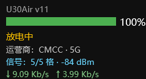

# U30Air 电量与网络状态桌面组件

在 Windows 桌面实时显示 ZTE U30Air 随身热点的**电量百分比与电量条、充电状态、
运营商与网络制式、信号强度、实时上下行速率** —— **每秒查询设备接口、每秒刷新显示**，
全程无需登录设备管理页。



---

## ✨ 特性

- **每秒真实查询设备**：守护进程以 1 秒间隔调用设备 goform 接口（非缓存滞后轮询）；
- **单进程常驻**：整个组件只占 1 个 PowerShell 进程，不产生进程风暴；
- **稳定显示**：电量条不闪烁、数值不跳零；
- **无残留**：原子写入 + 冲突重试 + 孤儿清扫，不会留下任何 `.tmp` 垃圾文件；
- **自愈**：守护进程意外退出时由皮肤 `FinishAction` 自动重新拉起；
- **免登录**：接口唯一"鉴权"是 `Referer` 请求头，无需密码、无需会话 Cookie。

## 📸 项目截图


> 实际尺寸 239 × 129 px，深色半透明背景，可直接拖动到桌面任意位置；
> 标题 `U30Air v11` 是版本水印，用于确认加载的皮肤版本。

## 🔌 接口逆向要点

设备管理页（`http://192.168.0.1/#login`）通过一个免登录接口取数：

```http
GET http://192.168.0.1/goform/goform_get_cmd_process
    ?cmd=<逗号分隔字段列表>&multi_data=1&isTest=false&_=<毫秒时间戳>
Referer: http://192.168.0.1/        ← 唯一的“鉴权”，缺失或改 https 即报
                                    {"Error":"none secure connection"}
```

常用字段（`multi_data=1` 时返回 JSON）：

| 字段 | 含义 | 示例 |
|---|---|---|
| `battery_vol_percent` | 电量百分比 | `100` |
| `battery_charging` | 充电状态：`0` 放电 / `1` 充电 / `2` 已充满 | `1` |
| `network_signalbar` | 信号格数（0–5） | `5` |
| `Z5g_rsrp` / `lte_rssi` / `network_rscp` | 信号强度（dBm，按制式择一） | `-84` |
| `network_provider_fullname` / `network_type` | 运营商 / 制式 | `CMCC` / `5G` |
| `flux_realtime_rx_thrpt` / `flux_realtime_tx_thrpt` | 下行 / 上行速率（**字节/秒**） | `1820` |

> 速率的显示换算：先 ×8 得比特/秒，再按 1024 步进格式化为 `b/s → Kb/s → Mb/s`。

完整的抓包方法、请求时序（页面实测约 1 次/秒）、字段字典、鉴权矩阵探测等，
见 **[U30Air数据抓取实现文档及接口逆向.md](U30Air数据抓取实现文档及接口逆向.md)**。

## 🛠 实现细节（v11 架构）

```text
设备 goform 接口 ──每秒 1 次──► rainmeter_daemon.ps1（常驻，仅启动一次）
                                   │ 原子写：临时文件 + 重试 + 孤儿清扫
                                   ▼
                               live.txt（UTF-8 无 BOM，"电量|状态|运营商|信号|速率"）
                                   │ WebParser UpdateRate=1（每秒重读本地文件）
                                   ▼
                       U30AirBattery.ini 的 5 个 Measure → 桌面组件刷新
```

真机 Rainmeter 4.5.26 实测得到的关键结论（均已落进最终代码）：

1. **RunCommand 不会自动执行** —— 需 `OnRefreshAction` + `OnUpdateAction=[!CommandMeasure 自己 "RUN"]`
   建立自循环；
2. `OnUpdateAction` 跟随"值更新"而非 `UpdateDivider`，会形成紧密循环，必须做节拍整形；
3. 高负载下 PowerShell 冷启动可恶化到 1.6~5.1 秒 —— 因此放弃"每 Measure 一个进程"，
   改为**单守护进程常驻**；
4. WebParser 读本地文件**必须带 `file://` 前缀**（否则被当 HTTP 解析而失败）；
5. `live.txt` **不能带 BOM** —— BOM 会混进正则第一组，文字看着正常但电量条数值恒为 0；
6. 输出编码：直接写 UTF-16LE 字节最稳（`OutputType` 默认即 UTF16，不依赖该选项）；
   路径变量用 `#CURRENTPATH#`（`#@#` 指向的是 `@Resources\`）。

实测终态：`live.txt` 的 mtime **每 1.00 秒前移**；像素级验证电量条 + 四行文字全部正常；
无任何 `.tmp` 残留；守护进程唯一（父进程 = `Rainmeter.exe`）。

## 📦 安装方式

1. 安装 **Rainmeter 4.5 或更高版本**（官网 <https://www.rainmeter.net/>）；
2. 把本仓库的 `U30AirBattery` 文件夹整体拷贝到：
   `文档\Rainmeter\Skins\U30AirBattery\`
   （即 `C:\Users\<用户名>\Documents\Rainmeter\Skins\U30AirBattery\`）；
3. 右键任务栏 Rainmeter 图标 → **刷新（Refresh）**，皮肤即出现在桌面；
4. 确保电脑与 U30Air 处于**同一局域网**（设备默认地址 `http://192.168.0.1`）。

**自定义设备地址**：编辑 `U30AirBattery\rainmeter_daemon.ps1` 顶部参数即可，
例如把 `-Device` 改为 `http://192.168.8.1`，然后右键 Rainmeter → 刷新。

**诊断**（皮肤无数据时按顺序看）：

| 现象 | 含义 | 处理 |
|---|---|---|
| 组件显示 `设备离线` | 守护进程活着但接口不可达 | 检查网络/设备地址 |
| 组件全空白 | 守护进程没起来 | 看皮肤目录下 `daemon_invoked.log` 是否在增长 |
| 数据不刷新 | 守护进程被结束 | 右键 Rainmeter → 刷新（会自动重新拉起） |

**运行期文件**（自动生成在皮肤目录内）：`live.txt`（每秒数据行）、
`daemon_invoked.log`（守护进程启动记录）。

## 📁 目录结构

```text
.
├─ U30AirBattery/                        Rainmeter 皮肤（最终产物）
│  ├─ U30AirBattery.ini                  皮肤本体（UTF-16 LE，中文注释）
│  └─ rainmeter_daemon.ps1               常驻守护进程（每秒查询 + 写 live.txt）
├─ U30Air数据抓取实现文档及接口逆向.md     抓取方法 / 接口契约 / 字段字典 / 实现细节
├─ screenshot.png                        README 项目截图
├─ README.md                             本文件
└─ LICENSE                               MIT 开源协议
```

## 📄 开源协议

本项目基于 **MIT License** 发布，详见 [LICENSE](LICENSE)。
